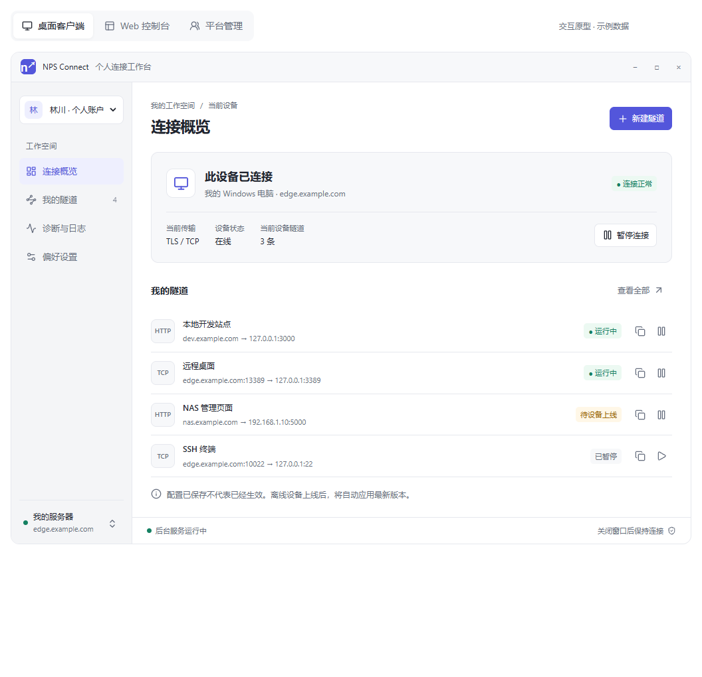
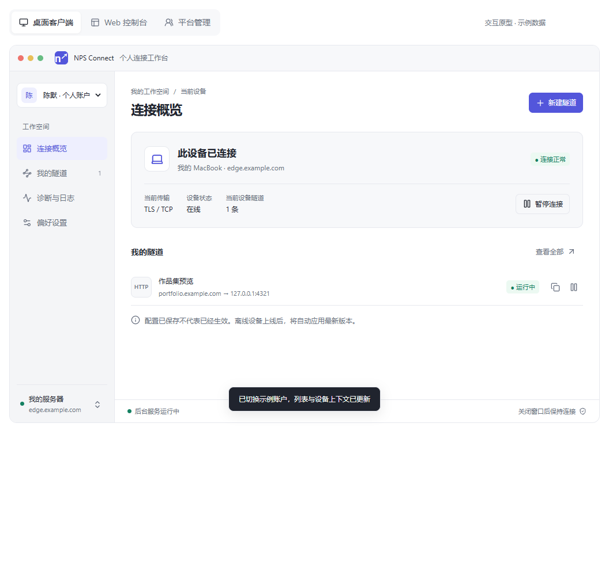
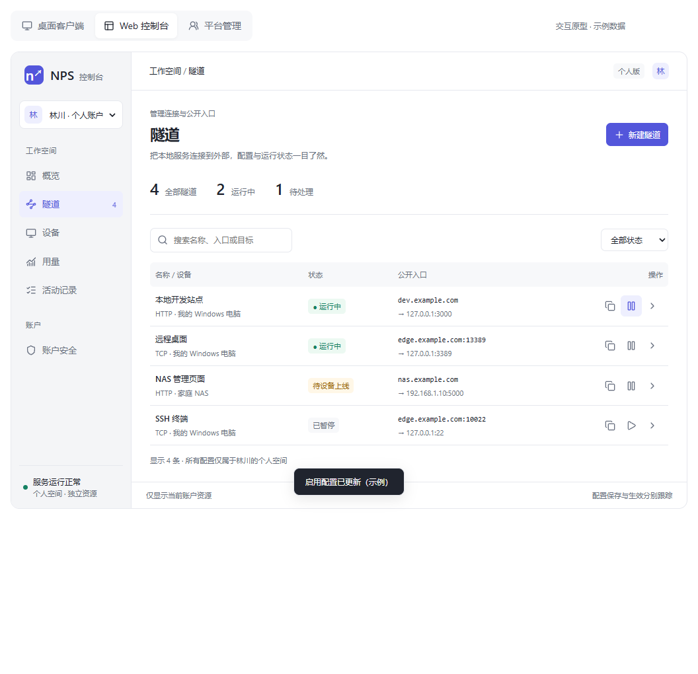
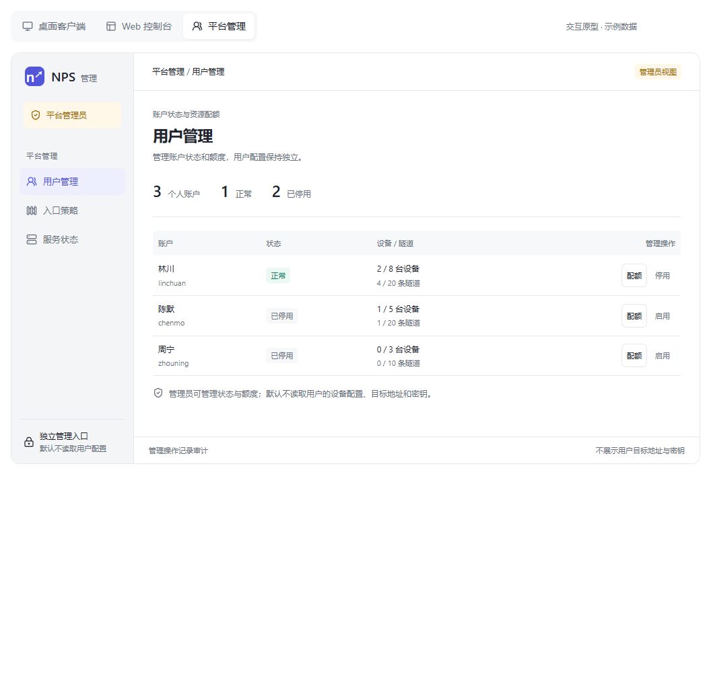

# NPS V2 架构方案与交互原型

本目录保存桌面客户端、Web 用户控制台和独立平台管理端的设计原型。界面及自有脚本采用中文说明与注释，第三方图标库保留原始版权声明。

## 查看方式

克隆或下载仓库后，用较新版本的 Chrome、Edge、Firefox 或 Safari 打开本目录的 [index.html](index.html)。请保留相邻的 `vendor` 目录，原型无需联网，也不需要启动 Go 服务、安装 Node.js 或连接 Codex。

GitHub 的文件页显示 HTML 源码，不能直接运行交互；可先查看下方截图，下载后再打开网页。旧浏览器如不支持 CSS `light-dark()`，请升级后查看。

## 完整文档

- [架构与交互设计](../../superpowers/specs/2026-11-24-nps-v2-design.md)：技术路线、模块边界、数据实体、个人账户隔离、Agent 生命周期、配置状态机、迁移与回退、性能目标。
- [分阶段改动计划](../../superpowers/specs/2026-11-24-nps-v2-roadmap.md)：P0–P5 改动范围、交付物、验收条件和操作流程。

推荐保留 Go 核心，重做账户/设备/配置模型及 Web；桌面壳通过 Win/macOS 实测决定。文档中的启动和内存数字是待确认的验收目标，原型不能证明已经达标。

## 交互评审范围

| 视图 | 可操作内容 |
|---|---|
| 桌面客户端 | 连接概览、隧道、暂停/恢复、地址复制、诊断、偏好开关 |
| Web 控制台 | 搜索、状态过滤、详情、三步新建、格式/入口冲突检查、配置应用反馈、设备、用量、安全 |
| 平台管理 | 账户状态、配额调整、停用影响确认、入口策略、服务状态 |

切换示例账户可查看资源清单变化；“陈默”示例展示 macOS 窗口样式，“林川”示例展示 Windows 窗口样式。预览顶部的平台管理按钮只是设计稿导航，不是正式产品的权限切换机制。

所有登录、隔离、诊断、网络连接、管理员操作与系统设置均为本地模拟，不读取真实凭据，不修改系统服务；刷新后恢复示例数据。真实资源隔离必须按架构文档在后端和数据库实施。

本次保留的评审调整：列表单元上下间距 **10px**，连接/详情等面板圆角 **11px**。这两个值保存在源文件 CSS 变量中，重新渲染或导出后保持一致。

## 界面预览

### Windows 桌面



### macOS 桌面



### Web 用户控制台



### 平台管理



## 修改与导出

主要文件：

- `prototype.fragment.html`：可维护的原型源文件，包含产品样式、示例数据和交互逻辑；关键状态、校验、事件、模拟回执与无障碍处理均有中文注释。
- `template.html`：独立网页的页面外壳、中文语言标记与离线安全策略。
- `build.py`：只使用 Python 标准库生成 `index.html`，从任意工作目录运行都可以。
- `index.html`：已生成的网页，可以直接打开；请同时提交源文件和导出结果。
- `verify.cjs`：可选的浏览器交互与响应式检查；不依赖作者个人机器路径。
- `vendor/`：Lucide 1.8.0 图标库和原始 ISC/MIT 许可声明。

修改后在本目录运行：

```sh
python build.py
```

## 可选验证

预览本身不需要 Node.js；只有重新执行浏览器检查时才需要安装开发依赖：

```sh
npm install
npx playwright install chromium
npm run verify
```

也可通过 `NPS_PROTOTYPE_BROWSER` 环境变量指定本机 Chrome/Edge 可执行文件，省略浏览器下载。验证使用离线浏览器上下文，检查页面无外部网络依赖；报告和临时截图写入被 Git 忽略的 `.verification/`。

更新 README 中的截图：

```sh
npm run verify -- --update-previews
```

检查包括：清单、搜索、状态、输入校验、公开入口冲突、保存与模拟回执、示例账户切换、macOS 样式、管理员配额/停用、1024/736/480/320px 布局、控制台错误和图标初始化。它们仅验证设计原型，不替代 Go 核心测试、权限集成测试或桌面安装包性能测试。

## 文档状态

这是可评审、可交接的设计基线；尚未执行生产代码重构。默认值、首版边界与待确认项都在架构文档中明确标记。设计涉及的账户权限、配置生效和迁移规则，以完整文档为准。
