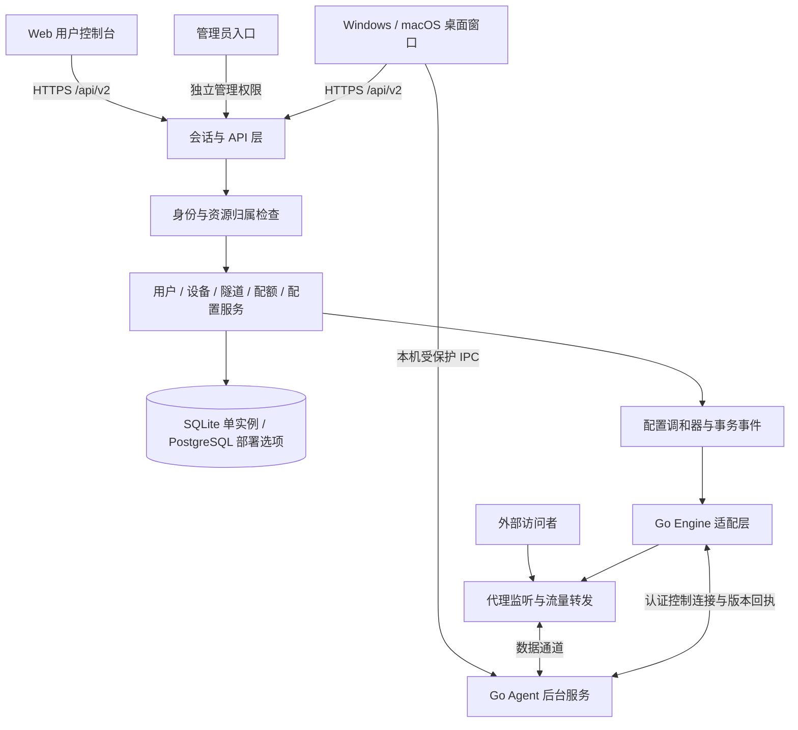
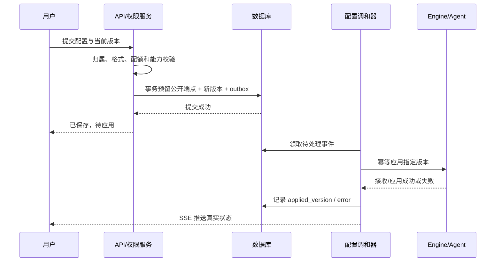

# NPS V2 架构与交互设计（评审草案）

日期：2026-11-24。状态：方向建议，待用户评审；未开始生产代码改造。

配套材料：[可离线打开的原型与中文维护说明](../../design/nps-v2/README.md)、[分阶段改动路线](2026-11-24-nps-v2-roadmap.md)。原型源代码与导出网页均已纳入仓库，不依赖作者本机的对话预览目录。

## 1. 目标与已知约束

用户明确要求：增加 Windows/macOS 桌面客户端；重做 Web，使配置更直观；个人账户完全隔离；桌面启动快、内存小；同时交付架构、改动路线和两端 UI 设计。

本方案默认：自部署、单服务节点起步；一个个人账户管理多台设备和多条隧道；不引入团队共享、组织、计费和集群调度。是否开放注册由管理员控制，默认关闭。以上是建议默认值，不代表用户已确认。

不以更换语言为目标，不同时重写所有穿透协议。UI 原型使用示例数据，只验证信息结构与交互，不代表真实的账号隔离、网络能力或桌面资源表现。

## 2. 当前代码与改造边界

| 现有部分 | 观察 | V2 处理 |
|---|---|---|
| `cmd/nps`、`server/`、`bridge/` | Go 服务端、转发和客户端桥接；依赖全局配置与文件模型 | 先保留转发行为，通过 Engine 接口适配，逐步拆除对 Web/存储的直接依赖 |
| `cmd/npc`、`client/` | 已有跨平台无界面客户端 | 提取可启动、停止、订阅状态的 Agent 服务，保持 CLI 可独立运行 |
| `gui/npc/npc.go` | 已有简单 Fyne 窗口，连接生命周期与 UI 绑定 | 作为桌面性能对照，不直接扩展为最终产品 |
| `lib/file/obj.go` | `Client` 同时保存设备信息与网页登录字段 | 拆出用户、设备、设备凭据、隧道、配置版本 |
| `lib/file/file.go` | clients/tasks/hosts 文件持久化 | 改为事务数据库，提供独立迁移器 |
| `web/controllers/`、`web/routers/`、`web/views/` | Beego 控制器与模板页面，已有用户/管理员分支 | 新增 `/api/v2` 与新前端，分阶段下线旧入口 |
| `go.mod` | 声明 Go 1.15，网络、UI、Web 依赖较旧 | 独立升级工具链与依赖，验证协议、构建和安全回归 |

工作区已有未提交的安全相关修改及测试。后续实现必须先确认并保留这些修改，不能用架构改造覆盖。此次仅新增设计文档和独立 UI 原型。

## 3. 方案比较与建议

| 方案 | 优势 | 代价 | 本方案态度 |
|---|---|---|---|
| Go 核心 + Wails 桌面 + Vue Web | Go 代码和前端逻辑可复用，维护技术种类少 | WebView 有进程与内存成本，必须实测 | 默认候选，需经过性能关卡 |
| Go 核心 + 无 WebView 桌面 UI | 有机会减小界面运行成本，复用 Go 引擎 | 两端 UI 实现分开；原生体验与可访问性需验证 | 与现有 Fyne 对照实测后决定 |
| Go 核心 + Tauri 桌面 | Rust 系统集成壳与 Go 引擎分工清晰 | 增加 Rust、跨进程和打包维护成本；仍有 WebView | 有明确集成收益时考虑 |
| 全量 Rust 重写 | 可统一 Rust 技术栈 | 协议、P2P、UDP、重连等重新验证，迁移风险最高 | 当前不推荐 |

推荐：先确定与 UI 框架无关的 Go Agent、API、账户模型；Web 使用 Vue 3 + TypeScript + Vite；桌面以 Wails 和 Fyne/无需 WebView 的候选做相同任务基准。最终桌面框架尚未选定，不能把本方案写成用户已同意 Wails。

## 4. 部署架构

采用模块化单体起步，不先拆微服务。管理与转发在逻辑上分层，初期同一服务端进程运行，后续有证据再拆部署。



管理 API 不承载业务转发数据。数据库不放在每个数据包的转发路径中；限额与权限变化通过运行态快照及撤销事件更新。

服务端发布保持简单：`nps-server` + 数据目录 + 可选外部 PostgreSQL；Web 静态资源随服务端发布。新 API 默认与 Web 同源。跨域来源必须显式配置。

## 5. 模块与建议目录

```text
cmd/nps/                  # 旧启动入口，迁移期保留
cmd/npc/                  # CLI 兼容入口
cmd/nps-agent/            # 新的无界面 Agent 入口
internal/domain/          # 用户、设备、隧道与配置版本
internal/auth/            # 登录、会话、令牌、设备登记
internal/application/     # 用例与资源授权；Web 与桌面共用 API
internal/repository/      # 数据访问接口与 SQLite/PostgreSQL 实现
internal/api/v2/          # REST / SSE / OpenAPI
internal/engine/          # 现有 server/bridge 的适配接口
internal/reconcile/       # 持久化事务事件、重试、应用状态
internal/agent/           # 生命周期、连接、配置应用、日志
internal/localipc/        # Windows named pipe / macOS Unix socket
internal/migration/       # 旧文件检查、导入、校验与报告
apps/web/                 # Vue 用户控制台 + 独立管理员路由
apps/desktop/             # 桌面壳与界面，框架待性能验证
packages/api-client/      # 由契约生成的 TypeScript 客户端
packages/design-tokens/   # 颜色、排版、间距、状态与文案规则
docs/                     # 协议、迁移、运维、交互与性能报告
```

目录是建议终态，按阶段建立，避免一次搬动所有旧包。Go 内部规则：HTTP handler 不直接修改 Bridge 或全局 sync.Map；通过用例服务和 Engine 接口操作。

## 6. 数据与隔离规则

### 核心实体

- `users`：独立用户身份，唯一登录名、密码哈希、状态；使用合适的密码哈希方案，迁移时不保留明文密码。
- `sessions`、`refresh_tokens`：网页登录会话和桌面登录状态，可失效与撤销。浏览器优先 HttpOnly/Secure/SameSite Cookie + CSRF 防护；桌面优先系统浏览器授权码 + PKCE，令牌放系统凭据存储。
- `devices`：`owner_user_id`、设备名、平台、版本、最近心跳、登记与撤销状态。
- `device_credentials`：绑定设备的独立高熵凭据、哈希、有效期、轮换和撤销记录；设备密钥不是用户登录密码。
- `tunnels`：`owner_user_id`、`device_id`、协议、公开端点、目标、用户期望状态。
- `config_revisions`：不可变配置快照、操作者、版本、应用状态、失败原因及回退关联。
- `public_bindings`：端口/域名的全局占用，数据库唯一约束，禁止不同账户冲突占用。
- `endpoint_policies`、`domain_verifications`：管理员配置可分配的端口池、监听地址和平台域名后缀；每个用户获得自己的平台子域命名空间。用户只能从授权范围申请端口；自定义域名通过 DNS TXT 等方式证明控制权后才允许启用。不能任意占用服务端监听 IP、保留端口或他人域名。
- `quotas`、`usage_buckets`：设备/隧道/连接/流量限制及聚合用量；配额检查需要事务或原子预留。
- `audit_events`：脱敏操作记录，按资源归属隔离，不记录密码、访问令牌和设备原始密钥。
- `outbox_events`：与配置提交同事务写入的待处理事件，避免保存成功但未触发应用。

所有用户资源通过服务器解析的当前用户身份查询，不能信任请求中的 `owner_user_id`。为设备与隧道建立所有者一致性的复合约束或等效事务校验，防止把 A 的隧道绑定到 B 的设备。凭据验证后由服务端推导设备归属。

普通用户查询他人资源统一返回不暴露存在性的错误。列表、详情、创建、修改、批量、导出、日志、SSE 订阅均必须应用相同隔离规则。缓存键、事件路由、后台任务也携带用户范围。UUID 不能替代授权。

默认管理员可以管理账户状态、配额和服务端运行情况；不默认读取用户目标地址、密钥和日志。若后续需要管理员支持访问，采用显式临时授权和审计。主机操作系统管理员仍属于基础设施信任边界，应用层隔离不等于防御服务器 root。

用户停用或设备撤销：撤销对应会话/凭据，通知 Engine 断开已有控制与数据通道，停止公开监听；不能只阻止下一次登录。

## 7. 设备接入与本地权限

### 首次接入

网页登录或桌面授权 → 创建设备/生成短时一次性登记码 → Agent 在 TLS 下兑换设备凭据 → 服务器绑定所有者 → Agent 报告能力与版本 → 显示在线 → 创建隧道。

桌面浏览器授权失败可提供手动短码或手动登记回退；不要求用户把永久 vkey 复制进命令行。设备原始凭据只在必要时生成和展示一次，遗失则轮换。

### 桌面进程

- 后台 `nps-agent`：运行连接、重连、隧道、限速与配置，不依赖窗口存在。
- UI：用户打开时启动，读取本地快照后异步刷新。启动时不等待云端、不加载完整历史、不加载 Web 管理后台。
- 首版按 OS 登录用户运行；Windows 每用户启动任务/启动项，macOS LaunchAgent。需要未登录运行时再提供显式安装的 Windows Service / macOS LaunchDaemon 模式。
- IPC 使用本机命名管道/Unix socket，并验证调用者、限制 ACL/文件权限。系统级模式必须验证登录用户与设备/配置归属；不暴露无认证的 localhost 管理端口。
- 关闭窗口释放窗口进程与 WebView（若有），Agent 继续连接。托盘若要求常驻，由单独轻量宿主或已验证的 Agent 原生集成承担，不能默认保留整个 WebView。
- “退出界面”“暂停当前设备”“退出并停止服务”明确区分；切换账户时必须先解除旧账户活动上下文，清理缓存与订阅。
- 普通注销撤销用户会话；独立登记的设备默认继续运行，但确认界面明确告知。用户可选“同时解除此设备”，该操作撤销设备凭据并停隧道。

评审后补充的默认决策：首版一个 Agent 实例仅绑定一个 NPS 账户，不支持多账户后台并行。A 注销后其 Agent 可继续运行；如果随后登录 B，UI 只提示“本机已绑定另一账户”，不显示 A 的设备名、配置、状态或日志。B 不能借同一 OS 用户身份读取或控制 A 的资源。切换本机绑定须先由 A 重新认证解除设备；无法认证时，OS 用户可执行明确标记会停止本机隧道的本地重置，删除本机凭据后再登记 B。服务端 A 的设备记录保留为离线，不能自动转归 B。本地重置与普通账户切换分开，不提供跨账户透明迁移。

IPC 分两类：不含私密资源的本机服务存在性检查；需要当前绑定账户授权证明的资源查询/控制。仅有 OS ACL 不足以允许后一类调用。登出 UI 后释放本机 UI 授权，Agent 的设备凭据仅用于后台联网。系统级多 OS 用户模式不在首版支持范围，需另做权限设计。

## 8. 配置生效流程与冲突

云端管理的隧道，以服务端配置为唯一期望状态来源。桌面修改同样调用管理 API，不直接覆盖本地连接配置；离线时允许保存明确标记的草稿，不宣称已生效。Agent 的本机服务参数单独管理。



- UI 同时区分“用户想启用”和“目前可用”，状态为：待设备上线、待应用、应用中、运行中、应用失败、已暂停、状态未知。
- 使用乐观锁/ETag；版本冲突返回 409，提供重新加载和查看差异，不能静默最后写入覆盖。
- 消息幂等，以资源 ID 与版本去重；重连时比较目标版本与已应用版本，丢弃过期回执。
- SSE 只传用户获授权的聚合状态；断线重新拉快照。实时日志需明确开启、有界缓冲和限速。
- 回退通过创建新版本实现；显示可能中断连接的修改，并说明哪些改动必须重启。
- 旧协议的回执能力不足时，标记“兼容模式/未验证”，不能把服务器写入成功等同于设备应用成功。
- 公开端点的分配与释放在事务中处理；更改失败不能把原来正常工作的绑定提前释放。第一版按明确的预留、切换、确认、释放状态机实现。

## 9. UI 设计系统

视觉方向：现代工具型界面，借鉴主流 Sidebar、Sheet、Data Table 组织方式；浅色/深色跟随系统，石墨中性色与少量靛蓝强调，避免大面积渐变、毛玻璃和常驻动画。参考的是交互模式，不宣称使用了 React shadcn/ui 组件。

基础规范：系统字体；正文 14px；标题 20–24px；4/8px 间距体系；控件高度 36–40px；触摸目标至少约 44px；圆角 8–12px；语义状态必须同时有文字。桌面设计参考宽度 960px，Web 参考 1440px；窄屏重排，不缩小整个界面。

当前评审原型采用列表上下间距 10px、连接/详情面板圆角 11px；这两个用户调整值已保存为 CSS 变量，重绘与离线导出后保持一致。

操作规则：每页一个主要动作；常用项优先，高级项渐进展开；表单就地校验并保留输入；危险操作展示受影响设备/隧道数量；提交后显示实际应用阶段；错误附带下一步动作；键盘可达且焦点可见；遵守减少动态效果偏好。

### 桌面信息结构

主导航：连接概览、我的隧道、诊断与日志、偏好设置。默认打开连接概览：当前服务器、当前设备、连接状态、常用隧道和最近问题。主动作是“新建隧道”；连接异常时主动作切换为“重新连接/诊断”。

不展示平台用户管理、全局服务器监控或其他用户资源。资源占用数字不能放假数据冒充测量结果；实际性能数据留在开发验收报告。

桌面创建：选择用途 → 填本地目标与公开入口 → 检查摘要 → 保存与应用 → 获得可复制访问地址。典型模板包括网站、TCP、UDP、SSH、远程桌面；模板只填默认值，不隐藏实际协议。

### Web 信息结构

用户区：概览、隧道、设备、用量、活动记录、账户安全。首屏突出需要处理的问题和资源清单，避免占满屏幕的装饰性图表。隧道列表支持搜索、状态过滤、查看配置、复制入口、暂停和诊断；右侧详情保留列表上下文。

管理员区使用独立入口与持续可见的管理标识：账户状态、配额、全局端口策略、服务器运行情况。不能靠前端切换角色获得管理权限。

空状态指引：先接入设备，再创建首条隧道。离线设备仍可配置，明确显示“待设备上线”。失败状态用可理解原因，例如“本地 3000 端口未监听”，并提供重新检测。

### 原型范围

本次原型覆盖：桌面/Web/平台管理切换、导航、示例账户上下文隔离、隧道搜索/过滤、详情、暂停/恢复、新建隧道分步表单、错误校验、应用状态反馈、诊断和偏好开关；管理端包含用户列表、配额修改、停用影响确认、入口策略与服务状态。Web 宽屏使用侧边详情/向导，窄屏改为顺序排列。所有网络、登录、隔离和管理员操作均为本地模拟；预览中的平台管理切换按钮是设计稿导航，不是正式产品的提权入口。

## 10. 桌面性能关卡

用户尚未给出具体内存上限。以下只作为建议验收目标，不是实测结果或已确认承诺：

| 场景 | 建议目标 | 测量方法 |
|---|---|---|
| 安装后正常冷启动到可操作窗口 | p95 ≤ 1 秒 | 固定 Win/macOS 参考机器与 Release 包，至少 20 次；首次安装/系统安全扫描另报 |
| Agent 已运行时重开窗口 | p95 ≤ 500 毫秒 | 网络断开也必须显示本地快照 |
| Agent + 必需托盘宿主，窗口已关闭 | 空闲物理内存目标 ≤ 40 MiB | 无活跃转发、已连接 1 台服务器、10 条空闲隧道，稳定 5 分钟 |
| 完整窗口已打开 | 总物理内存目标 ≤ 120 MiB | 包含 UI/Agent/WebView 所有相关进程；Win working set、macOS physical footprint 分开报 |
| 窗口关闭 30 秒后 | UI/WebView 进程退出 | 连接不中断，无残留 UI 进程 |
| 稳态空闲 CPU | 平均接近 0%，目标 < 0.5% | 固定机器，5 分钟均值，注明多核计量口径 |

同时记录下载体积、安装后体积、冷启动内存峰值、吞吐与不同活跃连接数下的内存增长。Windows 与 macOS 指标口径不同，不把数值直接当作框架优劣排名。

若候选无法达到用户确认的硬上限，优先精简/替换 UI 框架；有 Go 运行时或转发热点的剖析证据后，再考虑局部 Rust，不自动启动全量重写。

## 11. 分阶段交付与依赖

| 阶段 | 内容 | 验收出口 |
|---|---|---|
| P0 基线与决策 | 保护现有修改、功能/协议清单、两端 UI 评审、Win/Mac 桌面候选基准 | 确认 UI 与性能预算、候选框架；记录旧协议行为与迁移范围 |
| P1 身份与存储 | 独立用户/设备/凭据/隧道、事务存储、API 契约、授权边界 | A/B 账户全接口隔离；设备撤销与用户停用实际断连 |
| P2 引擎与配置 | Engine 适配、配置版本/outbox/状态机、现有转发兼容、迁移工具 | 新 API 能驱动旧核心；故障重试与冲突不破坏正常配置 |
| P3 新 Web | 用户登录、设备、隧道向导、详情、诊断、用量、安全与管理入口 | 首条隧道端到端完成；空/错/离线/冲突状态可处理 |
| P4 桌面产品 | 选定壳、Agent/IPC、登录登记、托盘、配置、诊断、安装 | Win/Mac 安装包与生命周期验收，达到确认后的性能预算 |
| P5 迁移与发布 | 导入演练、灰度、备份恢复、版本兼容、签名与更新 | 真实数据演练通过；回退步骤可执行；发布清单可复现 |

P0 后 P1 与桌面外壳研究可按稳定契约推进；P3/P4 完整联调依赖 P2。以上是交付路线，不是未经评审就执行的代码级计划，也不对工期作承诺。

首个可用里程碑：登录 → 登记设备 → 创建 TCP/HTTP 隧道 → 应用回执 → 外网访问 → 查看原因并暂停。UDP/SOCKS5/P2P 等现有能力保留兼容入口，最终切换前全部验证；暂不支持的新界面功能必须明确标出，不能静默删除旧能力。

## 12. 旧版本迁移与回退

1. 只读盘点：区分真实 JSON 对象与当前带分隔符的文件记录；检测损坏记录、重复用户名、重复 vkey、端口与域名冲突、缺失设备引用。
2. 明确映射：旧 `Client` 是设备，同时带网页登录字段。用户名唯一且非空时可映射为一个账户；同名多设备或冲突信息必须生成待确认映射，不猜测合并归属。
3. 没有独立登录身份的设备先放入隔离的待认领状态，不默认归任何普通用户；管理员显式完成分配后启用。
4. 迁移到独立新数据库，保留原 ID→新 ID 映射；对旧明文密码直接做密码哈希迁移，并要求后续修改；含冲突凭据的记录不自动激活。
5. 首版兼容旧 npc 的边界：在确认现有安全修复已生效后可短期保留受控兼容入口；旧 vkey 映射到唯一设备，冲突则阻断并人工处理；不能借兼容绕过账户状态/配额。
6. 切换时暂停管理写入与旧进程，生成文件/数据库备份，完成最后一次导入与校验，再启动 V2。管理状态只有一条写路径，旧 Web 不再写入新系统。初期采用维护窗口，不承诺零中断。
7. 上线前比较设备/隧道/域名数量、归属、公开端点、配额和实际连接。提供 `--dry-run` 与机器可读迁移报告，不把密钥写进报告。
8. 回退恢复切换前备份和旧二进制；V2 启用写入后的增量不会自动回灌旧文件，必须先冻结写入并导出差异，用户知情后选择重放或放弃增量。禁止把旧进程与新进程同时绑定同一公开端点。

## 13. 验证与发布

- 授权集成：两个账户交叉读取/修改/删除/批量/导出/日志/SSE/设备登记；越权失败且没有副作用。
- 协议回归：TCP/UDP/HTTP/HTTPS/SOCKS5/P2P、重连、断网、服务端重启、限速和流量计量；逐项建立现有行为基线。
- 配置一致性：重复请求、重复事件、过期回执、409 冲突、端口竞争、离线设备、应用失败、数据库提交后进程崩溃与恢复。
- 桌面生命周期：启动、关窗、重开、注销、切换用户、休眠唤醒、网络切换、代理环境、卸载及更新。
- 安全基础：会话和设备凭据独立、密码哈希、CSRF、TLS、IPC 权限、日志脱敏、登录限速与管理员审计。
- 发布：Windows 签名安装器、macOS 签名/公证并在 macOS CI 构建验证；更新包验证签名与来源，服务与窗口协议版本兼容，失败可回退。
- 性能：Release 构建真实机器实测，不能用浏览器原型和开发构建结果代替。

## 14. 待评审的关键选择

1. 桌面物理内存预算：本稿暂用后台 40 MiB、开窗 120 MiB 的目标，用户可以要求更严。
2. 首版按用户登录后自启动；是否必须未登录也保持连接，将决定系统级服务安装范围。
3. 默认管理员不读取用户具体配置；若需要运维支持访问，需另定显式授权规则。
4. 单节点 SQLite 为默认，PostgreSQL 为部署选项；首版不做多节点高可用。
5. 一个 Agent 绑定一个账户；切换绑定须正常解除旧设备，或明确执行会停止连接的本机重置。正常解除撤销服务端登记，本机重置仅删除本机凭据，保留原账户的离线设备记录；普通注销不解除。这是评审后补充的建议。
6. 公开入口来自管理员授权的端口池/域名空间，自定义域名先验证控制权。这是评审后补充的建议；旧版未验证的域名迁移后须认领/验证才能按新策略启用。

这些选择不阻碍本次架构与交互评审，但在相应功能实施前需要确定。

独立 builder check 已完成；发现的 Agent 跨账户绑定、公开入口授权两项边界已按以上保守默认值补齐，等待用户评审。

## 15. 参考

- Wails 架构：https://wails.io/concepts/architecture/
- Tauri WebView：https://v2.tauri.app/reference/webview-versions/
- Tauri 外部进程：https://v2.tauri.app/develop/sidecar/
- Sidebar 模式参考：https://ui.shadcn.com/docs/components/base/sidebar
- Material 3 交互/可访问性基础：https://m3.material.io/get-started
